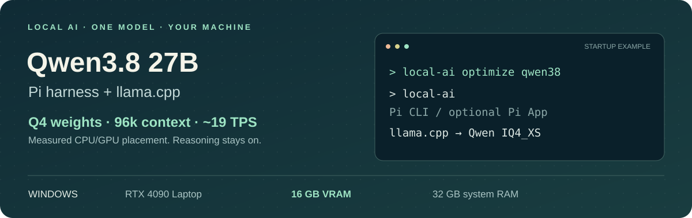
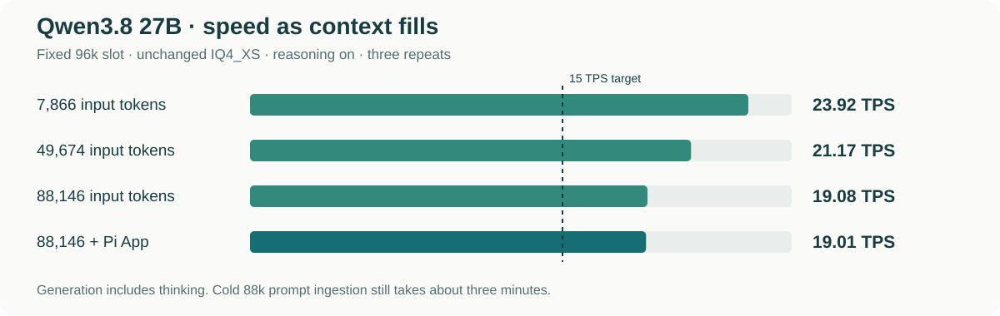

# local-agent-pi-llama-cpp-16gb

**Qwen3.8 27B, Pi harness and llama.cpp on one 16 GB GPU.** A Windows setup checklist, one-command launchers and a measured CPU/GPU configuration that reached **19 TPS with a 96k context window**. Pi App is an optional desktop interface.

| Model | Context slot | Long-input generation | Tested hardware |
|:--|:--|:--|:--|
| **Qwen3.8 27B · UD-IQ4_XS** | **98,304 tokens** | **19.01 TPS** with Pi App open | RTX 4090 Laptop · 16 GB VRAM · 32 GB RAM |

> Measured on the development Windows machine, with reasoning enabled. This is a tested profile, not an automatic speed guarantee or a claim of dependable coding over every token. Clean-machine installation and native macOS/Linux inference remain unverified.

## Start here: the exact Qwen model

Use **`Qwen3.8-27B-UD-IQ4_XS.gguf`**, a 14.25 GB Q4 file. The measurements do not apply to Q3, other Q4 variants, or Flash-Next.

Get the [pinned IQ4_XS model from Unsloth on Hugging Face](https://huggingface.co/unsloth/Qwen3.8-27B-GGUF/blob/4ca720788d1e01f1bff70c033e0d0028fd02e502/Qwen3.8-27B-UD-IQ4_XS.gguf). The optimizer verifies its SHA256 before saving configuration. Weights remain separate from this repository.

## From fresh clone to local agent

| Done | Step | Result |
|:--:|:--|:--|
| ☐ | Install PowerShell 7, Git and the NVIDIA driver | Windows prerequisites ready |
| ☐ | Clone the repository and run the core installer | Pinned Node, pnpm, Pi, search tools and llama.cpp |
| ☐ | Download the pinned Qwen IQ4_XS file | One model, verified quantization |
| ☐ | Apply the Qwen profile | Saved path, 96k context and measured offload settings |
| ☐ | Run acceptance | Real answer and a verified Pi read/edit/test loop |
| ☐ | Start `local-ai` | Pi and llama.cpp start together |

```powershell
git clone https://github.com/rolfhelder/local-agent-pi-llama-cpp-16gb.git
cd local-agent-pi-llama-cpp-16gb
.\bin\local-ai.cmd install
```

The installer provides the core runtime; **it does not download model weights**. It also lets you choose a working folder. Settings and sessions stay under that folder's ignored `.pi/local-ai/`; runtimes and models stay separate.

Follow the [core installation guide](docs/INSTALL.md) for prerequisites, model folders and first-run acceptance.

## Apply the 19 TPS profile

After downloading the model, apply the configuration using its actual location:

```powershell
local-ai optimize qwen38 --model-file "D:/AI/models/Qwen3.8-27B-UD-IQ4_XS.gguf"
local-ai test --model qwen38 --run
local-ai
```

If Qwen is already in the registered model folder, use simply **`local-ai optimize qwen38`**. It shows checksum progress, backs up local configuration and saves the model path and 98,304-token window. Both launchers use the same offload recipe. It starts no model, downloads nothing and does not benchmark or guess your hardware's optimum.

The [Qwen setup and optimization guide](docs/QWEN38.md) explains every setting, manual configuration, recovery and why the model size alone does not predict VRAM use.

## What made it faster?

We kept the **same Q4 weights** and enabled reasoning. The gain came from where tensors run and how much context/buffer memory fits alongside Windows.

| Setting | Measured profile | Purpose |
|:--|:--|:--|
| Context | 98,304 tokens | Meets the 96k target while keeping decode above 15 TPS |
| CPU FFN groups | **58, 59, 63** | Moves selected large FFN weights to RAM; attention stays on GPU |
| KV cache | `q4_0` keys and values | Reduces cache memory separately from model quantization |
| Generation / batch threads | **24 / 24** | Beat 32 threads on the tested hybrid CPU |
| Batch / microbatch | **512 / 64** | Keeps compute buffers smaller |
| Flash Attention | On | Uses the tested CUDA attention path |
| Reasoning / response cap | Medium, 2,048 budget / 8,192 total | Preserves reasoning and room for an answer |
| MTP drafting | Off | Its short-input gain did not validate a better long-context default |

Pi CLI **1.3.0**, llama.cpp **b11669 / CUDA**, one model and one inference request at a time. The launcher binds to loopback and stops its owned server when Pi exits.

## Measured performance, including the wait



| Actual input | Median generation TPS | Cold prompt ingestion | Cold request through 512 output tokens |
|--:|--:|--:|--:|
| 7,866 | 23.92 | 12.61 s | 34.03 s |
| 49,674 | 21.17 | 87.26 s | 111.53 s |
| 88,146 | 19.08 | 177.34 s | 204.38 s |
| 88,146 · Pi App open | **19.01** | 173.62 s | 200.70 s |

Three generations per row; the first prompt is cold and later repetitions reuse its cache. TPS includes reasoning. The 512-token throughput outputs are deliberately incomplete; completed correctness checks were separate.

Peak adapter use with Pi App was **97.5%**, leaving about **400 MiB**. At least **5.47 GB RAM** remained available. A 131k configuration completed at about **12.7 TPS**, below the target; the earlier twelve-CPU-group capacity profile reached only 9.01 TPS. This is a measured tradeoff, not a global context maximum.

The [full performance checklist and results](docs/QWEN38-PERFORMANCE-TODO.md) records rejected placements, MTP, memory and latency. The context results should be read alongside the [evaluation methodology](docs/TESTING.md), which distinguishes allocation, recall, speed and coding quality.

## Evaluations: what to expect

The selected Qwen profile passed **5/5 exact-value recall** at 88,237 input tokens, with valid JSON and no tools. Both baseline and optimized placement passed a small Pi repair: observe failure, inspect, edit, rerun, preserve checks and pass **1,785 hidden assertions**.

That is not evidence of broad coding-agent reliability. Larger localization tasks produced long searches, compactions and unsuccessful runs; more reasoning did not guarantee better decisions. The earlier four-model `/effort` task also had no complete success. These limitations remain documented rather than hidden behind a speed number.

The [evaluation methodology and historical results](docs/TESTING.md) explain what passed, what failed and what the tests cannot establish.

## Pi extensions

| Standard capabilities | Optional capabilities |
|:--|:--|
| Context usage and session timing | Web search and bounded page reading |
| Thinking controls | Playwright CLI browser automation |
| Destructive-command approvals | Research/retrieval tools |
| Windows TypeScript LSP | Computer use |

Ordinary local commits run automatically; destructive actions request approval. Guardrails are an ergonomic protection, **not an OS sandbox**. Optional tools contact external services where their function requires it.

See the [extensions, hooks and guardrails guide](docs/EXTENSIONS.md) for configuration and validation levels.

## Prefer a window? Add Pi App

```powershell
local-ai-app
```

The optional desktop connects to the same Qwen profile, with an effort picker and Files, Run, Context and Browser panels. Quit from its tray to release the model. Resident memory reports Electron RAM, not llama.cpp VRAM.

Follow the [Pi App setup guide](docs/PI-APP.md) for installation, local connection, extension visibility and thinking settings.

## Historical data and platforms

This repository supports one operational model profile: **Qwen3.8 27B UD-IQ4_XS at 98,304 tokens, measured at 19.01 TPS with Pi App open**. Gemma, Qwen3.5, OmniCoder, GPT-OSS and Flash-Next figures are retained only as historical experiment data; they are not download, setup, or runtime recommendations. See the [context and TPS comparison](docs/MODELS.md#historical-context-and-tps-data).

llama.cpp also supports macOS/Metal and Linux/CUDA. Our **Windows 16 GB profile is not validated on those platforms**; CPU placement and memory assumptions must be rechecked. The [installation guide's platform section](docs/INSTALL.md#macos-and-linux) provides the native baseline and shell alias.

## What stays local

| In Git | Local and ignored |
|:--|:--|
| Setup guide, measured profile and sanitized results | Weights and downloaded runtimes |
| Launchers, extensions and tests | Machine paths, credentials and configuration backups |
| Pinned download manifest | Sessions, private prompts and research diary |

Legacy `pia` / `pia-app` names remain compatibility aliases. Original code and documentation use the [MIT license](LICENSE); dependencies, applications and model weights retain their own licenses.

## Slop warning

This repo was mostly done by AI agents. I'm sharing this because I think this may be useful for other people. Be warned this may contain slop and bad code I didn't review line by line. I tested this on my machine, made it work and put the end result into this repo.
